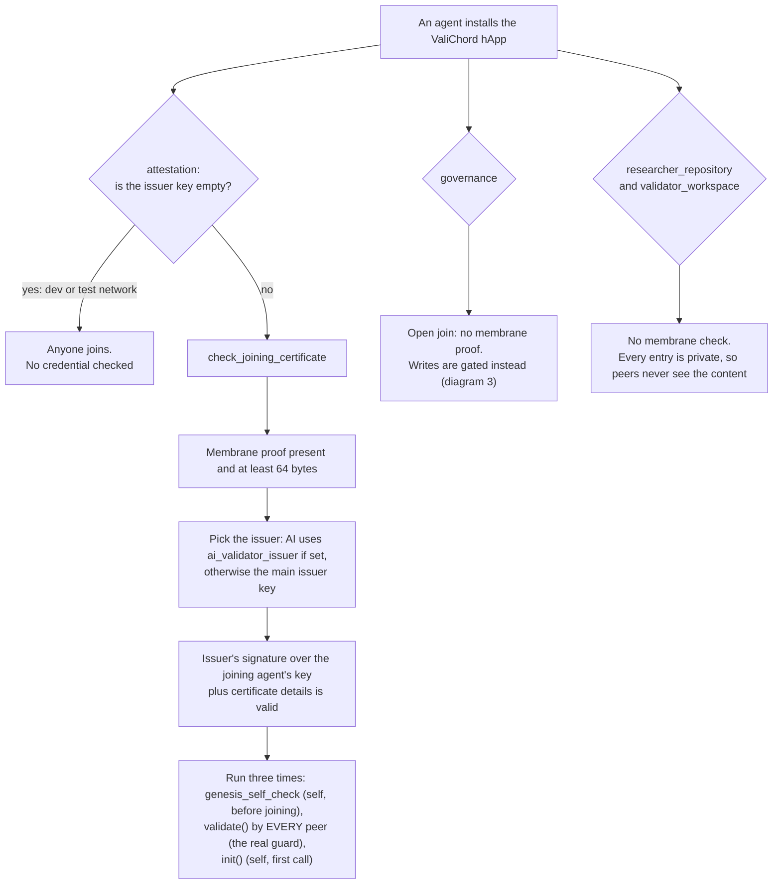
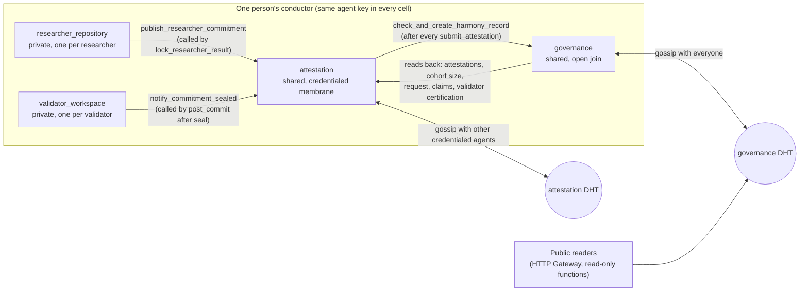

*Who may join each of the four networks, drawn from the code (2026-10-18). Notes: [DIAGRAMS.md §4](DIAGRAMS.md#4-the-membranes-who-may-join-each-dna). The four are separate networks, not nested, and governance is the open one.*

# 🛡️ ValiChord: The 4-DNA Membrane Architecture

ValiChord is built as a series of independent but connected "bubbles" (technically called DNAs) rather than a single monolithic program. Each bubble has its own membrane — a digital boundary that controls who can join the network and what information is allowed to leave. This ensures that sensitive research data stays private while the proof of the science becomes public.

---

# 1. Researcher Repository DNA (Private Membrane)

**Function:** Runs on the researcher's or institution's own computer. Nothing leaves this bubble except a cryptographic fingerprint (hash) of the data.

**Role:** This is the "home base" that holds the original research — the raw code, datasets, pre-registered protocols, and early notes.

**Privacy:** Sensitive information (such as private patient records or commercially sensitive data) stays inside this bubble permanently. It never touches the shared network, making the system GDPR compliant by its very nature — not as a policy overlay, but as a structural fact.

**What it stores:** ResearchStudy, PreRegisteredProtocol (locked and immutable once registered), VerifiedDataSnapshot (a timestamped hash of the dataset at the moment of validation), LockedResult (the researcher's sealed result metrics and cryptographic nonce — cannot be changed and never leaves this DNA; in the default privacy mode the researcher may still delete it, to honour erasure rights).

---

# 2. Validator Workspace DNA (Private Membrane)

**Function:** A persistent private workspace belonging to a single credentialed validator.

**Role:** This is where the actual reproduction attempt happens. The validator downloads the researcher's code and data, re-runs it independently, and records their findings here. Crucially, the findings are **sealed** (committed) as a private entry before any other validator can see them — preventing groupthink and ensuring each validator's judgement is genuinely independent.

**Privacy:** No other validator can see inside this workspace. The sealed assessment stays here. Until the reveal, only a cryptographic proof that it exists travels to the shared network; at the reveal, the validator publishes the same findings openly (see step 4 below).

**What it stores:** ValidationTask (the assigned study), ValidatorPrivateAttestation (the sealed private assessment — immutable once written, never leaves this DNA), DeliberateAbstention (a record that the validator chose not to take part).

---

# 3. Attestation DNA (Shared DHT / Credentialed Membrane)

**Function:** A shared digital coordination layer for credentialed validators. Joining requires a membrane proof — a cryptographic credential signed by an authorised issuer (an institutional body for human validators; the ValiChord operator for AI validators). Every member of the network checks that credential for themselves, not just the newcomer's own software. The credential also fixes the validator's starting tier, so nobody can award themselves a higher one.

**Role:** This DNA manages the blind commit-reveal protocol and records the public outcome of each validator's work. It does not store the research itself — only the acts of validation.

**How the commit-reveal works — fully symmetric for both validators and researcher:**

**At submission (before any validator starts work):**
- The researcher seals a hash of their result metrics to the shared network (`ResearcherResultCommitment`). Their actual metrics stay in DNA 1. The hash is the envelope — sealed before anyone else acts.

**During validation (commit phase):**
1. Each validator seals their private assessment in DNA 2 (the Commit).
2. This automatically writes a **CommitmentAnchor** to DNA 3 — a public, zero-content proof that a commitment was made, without revealing what was found.
3. When all validators have committed, a **PhaseMarker** is written to the shared network, opening the reveal window. Validators discover this by checking the network (polling), not by receiving a message — so no validator can gain an advantage from faster internet.

**At reveal (once the reveal window is open):**
4. Validators publish their **ValidationAttestation** — their full public findings — to DNA 3. These are permanent and cannot be changed.
5. The researcher publishes their **ResearcherReveal** — the structured result metrics, checked by the network against the hash committed at submission. Anyone can now compare what the researcher originally claimed against what each validator independently reproduced.

**What it stores:** ValidationRequest, ResearcherResultCommitment, ResearcherReveal, CommitmentAnchor, PhaseMarker, ValidationAttestation (all immutable after publication), ValidatorProfile, StudyClaim and StudyClaimRelease (a validator taking, or giving up, a place on a study).

---

# 4. Governance & Harmony Records DNA (Public DHT)

**Function:** A publicly readable library for the whole scientific community, accessible via a standard web API — no specialist software required.

**Role:** Stores the final Harmony Records, Reproducibility Badges, validator reputation scores, and governance decisions. Anyone — journals, funders, other researchers, or the public — can query this layer to verify the reproducibility status of any study.

**Control:** A Harmony Record can only be written by a validator who took part in the round, and it must carry every participating validator's own signed findings — so nobody can list validators who never took part, or claim a result their findings do not support. Reputation scores and governance decisions can only be written by a key fixed into the DNA at deployment. The rules are enforced by every peer on the network independently — there is no central administrator who could override them.

**What it stores:** HarmonyRecord (the final validated outcome — immutable), ReproducibilityBadge (Gold / Silver / Bronze / Failed), ValidatorReputation, GovernanceDecision.

*How the four networks connect. Notes: [DIAGRAMS.md §1](DIAGRAMS.md#1-the-four-dnas-and-who-talks-to-whom).*

---

## Plain English Glossary

| Technical Term | Plain English Explanation |
|---|---|
| **ValiChord** | A "distributed immune system" for science that verifies whether research results can actually be reproduced independently. |
| **DNA (Holochain)** | The Club Rulebook. In this system, a "DNA" is a specific set of rules that defines a small, independent peer-to-peer network. |
| **Membrane** | The Bouncer. A security boundary that decides who is allowed into a specific network and what data is allowed to leave. |
| **Membrane Proof** | The Credential. A cryptographic certificate issued by an authorised body, required to join the Attestation network. Like a professional licence — you can't self-certify. |
| **Shared DHT** | A Neighbourhood Bulletin Board. A way for people to share information without a central "Big Brother" server; every participant holds a small piece of the board. |
| **Cryptographic Hash** | A Digital Fingerprint. A unique code representing a file. If even one comma changes in the file, the fingerprint changes completely — making tampering immediately detectable. |
| **Commit-Reveal** | The Sealed Envelope. You put your answer in an envelope on the table (Commit) and only open it (Reveal) once everyone else has done the same. No-one can change their answer after seeing others'. |
| **CommitmentAnchor** | The Validator's Envelope on the Table. A public, zero-content record that a specific validator has sealed their assessment — visible to all, but revealing nothing about what was found. |
| **ResearcherResultCommitment** | The Researcher's Sealed Envelope. A hash of the researcher's result metrics published to the shared network at submission — before any validator starts work. The actual numbers stay private until the reveal. |
| **ResearcherReveal** | The Researcher's Open Envelope. The researcher's verified result metrics, published at reveal time and cryptographically proven to match what was committed at submission. Anyone can now compare researcher-declared vs validator-reproduced values. |
| **PhaseMarker** | The Starting Pistol. A permanent record written to the shared network when all validators have committed, opening the reveal window for everyone simultaneously. |
| **ValidationAttestation** | The Validator's Open Envelope. A validator's full public findings, permanently recorded on the shared network. Cannot be changed or deleted. |
| **Harmony Record** | The Verdict. The final permanent record of a completed validation round — including the outcome, the level of agreement between validators, and who participated. Publicly readable by anyone. |
| **Reproducibility Badge** | The Hallmark. A Gold, Silver, Bronze, or Failed stamp issued to a study based on how many validators reproduced it and how closely their findings agreed. |
| **Data Locality** | Keeping it at Home. Keeping data on your own device rather than sending it to a cloud server — the architecture enforces this, it is not just a policy. |
| **Immutable** | Carved in Stone. Once information is recorded on the network, it can never be changed or deleted — by anyone, including ValiChord's own operators. |
| **Tamper-Evident** | A Wax Seal. You might not be able to stop someone trying to change data, but you will immediately see that the seal is broken if they try. |
| **Static Analysis** | The Proofread. Examining files and code to find obvious problems without actually running the program. |
| **Agent-Centric** | Your Phone, Your Rules. Unlike blockchain where everyone shares one ledger, each participant in Holochain maintains their own personal record — the network emerges from many individuals rather than one shared database. |
