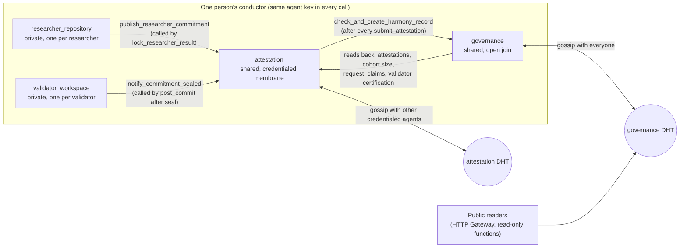
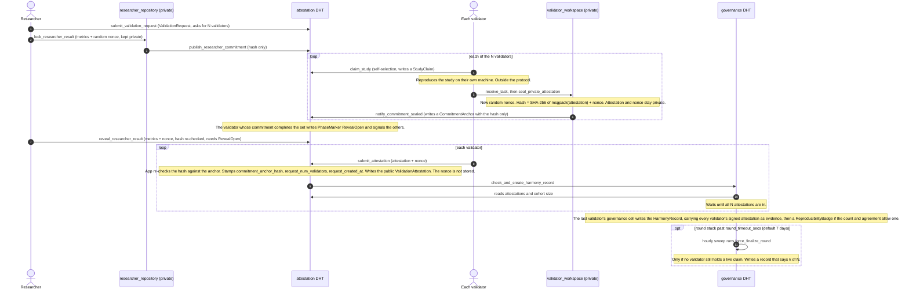
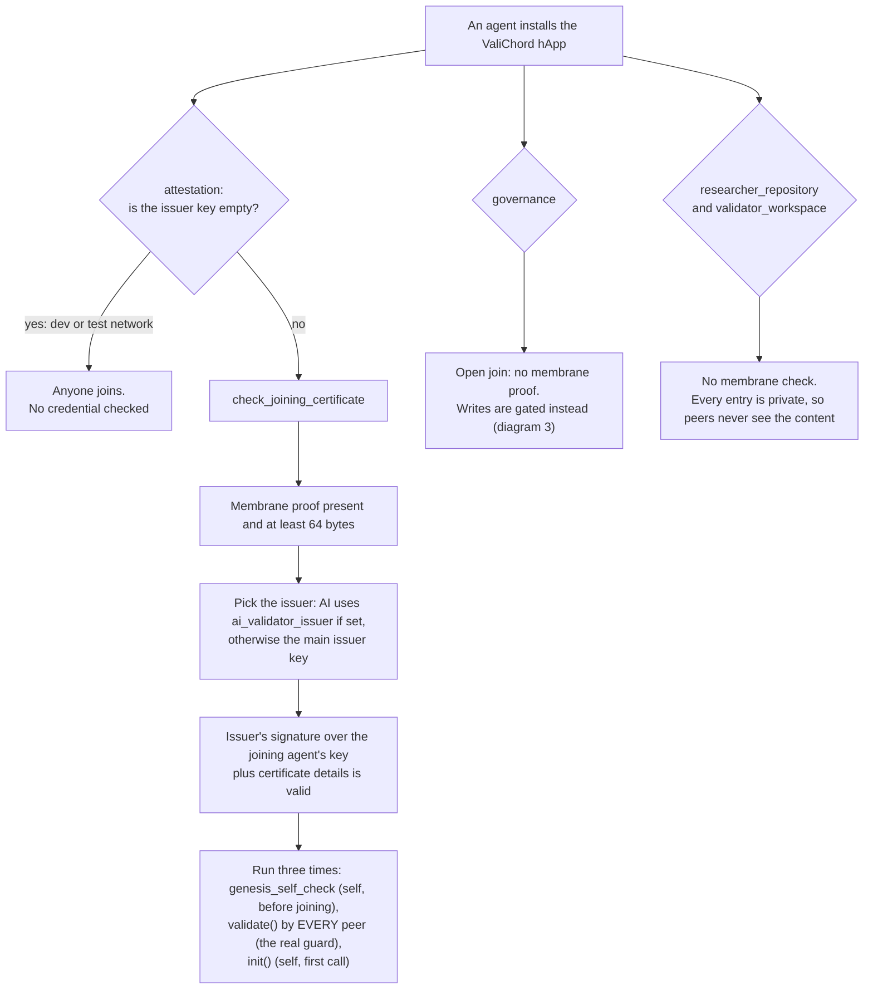

# ValiChord Diagrams

These four diagrams show how the ValiChord protocol (`valichord/`) actually works. They were
drawn from the code on 2026-10-18 (Holochain 0.7.1, after PR #47), not from other documents.
GitHub draws them from text, so anyone can correct them in a normal pull request.

If a diagram and the code disagree, the code wins: please fix the diagram. The files each
diagram was checked against are listed under it.

1. [The four DNAs and who talks to whom](#1-the-four-dnas-and-who-talks-to-whom)
2. [One validation round, end to end](#2-one-validation-round-end-to-end)
3. [What enforces what](#3-what-enforces-what)
4. [The membranes: who may join each DNA](#4-the-membranes-who-may-join-each-dna)

A note on words: a **DNA** is one Holochain app network with its own rules. A **cell** is one
person's copy of a DNA running on their own machine. A **coordinator** is the code a person's
own app runs. **validate()** is the rule check that *every peer* runs on everything published to
the network, so a modified app cannot skip it.

---

## 1. The four DNAs and who talks to whom

**What it shows.** Each person runs all four cells on their own machine. The two private DNAs
never publish their entries to the shared network: they only pass a hash across to the
attestation DNA. The cross-DNA calls are all *the same agent calling its own other cell*
(`CallTargetCell::OtherRole`), never one person calling another.

**What it leaves out.** It does not show remote signals (the "reveal is open" nudge sent between
validators' attestation cells), the hourly governance sweep, or which person does which step
(see diagram 2). In practice a researcher uses the researcher_repository cell and a validator
uses the validator_workspace cell, though the hApp installs all four for everyone.

*Checked against:* `researcher_repository_coordinator/src/lib.rs` (`lock_researcher_result`),
`validator_workspace_coordinator/src/lib.rs` (`_post_commit_inner`),
`attestation_coordinator/src/lib.rs` (`call_governance_fire_and_forget`),
`governance_coordinator/src/lib.rs` (`call_attestation_zome_opt` and its callers), `happ.yaml`.

---

## 2. One validation round, end to end

**What it shows.** The order of a normal round, using the real function names. Validators
choose studies themselves (`claim_study`); nobody assigns them. Each validator's verdict is
sealed as a hash before any verdict is public, and is only revealed once every validator has
committed. The HarmonyRecord is written by whichever validator's app happens to finish the set,
and peers then check it against the signed attestations it carries (diagram 3).

**What it leaves out.** Releasing or reclaiming a claim, abstentions, difficulty assessments,
retries when a cross-DNA call fails, and the badge sometimes being written on a later call
(the first attempt can be blocked by Holochain's rule against a cell calling back into a cell
that is already busy). `submit_attestation` does not itself check that RevealOpen has been
written: waiting for it is left to the app. The researcher's reveal is shown in one place but
can happen any time after RevealOpen.

*Checked against:* `attestation_coordinator/src/lib.rs` (`submit_validation_request`,
`claim_study`, `notify_commitment_sealed`, `publish_researcher_commitment`,
`reveal_researcher_result`, `submit_attestation`), `validator_workspace_coordinator/src/lib.rs`
(`seal_private_attestation`, `post_commit`), `governance_coordinator/src/lib.rs`
(`check_and_create_harmony_record`, `force_finalize_round`, `write_harmony_record`,
`sweep_timed_out_rounds`).

---

## 3. What enforces what

This is the most important diagram. "Checked by every peer" means a modified app cannot get
round it: the network rejects the entry. "Checked only by the honest app" means the rule holds
only if the person runs the unmodified ValiChord app. "Outside the protocol" means no code
checks it at all.

```mermaid
flowchart TB
    subgraph PEER["Checked by every peer in validate()"]
        direction TB
        P1["Joining certificate signed by the issuer<br/>(attestation DNA membrane)"]
        P2["ValidatorProfile tier equals what the certificate grants<br/>(AI: issuer's initial tier, Human: Provisional)"]
        P3["StudyClaim: not your own study, institution declared<br/>and different from the researcher's"]
        P4["ValidationRequest asks for at least 1 validator<br/>and at least the DNA's minimum_validators"]
        P5["Chain: attestation to its own CommitmentAnchor to the ValidationRequest.<br/>Same author, same study, discipline, cohort size and request time match"]
        P6["RevealOpen lists commitments from all N validators<br/>(and its author is one of them)"]
        P11["Researcher's reveal names the real request and<br/>an earlier researcher commitment for the same study"]
        P7["No edits or deletes of requests, claims, anchors, attestations,<br/>phase markers, researcher commitments, reveals, HarmonyRecords, badges"]
        P8["HarmonyRecord: author took part, no duplicates, one signed attestation<br/>per validator, signatures valid, outcome and agreement recomputed,<br/>cohort size matches, a short record only after round_timeout_secs"]
        P9["Badge: points to a real HarmonyRecord, author took part,<br/>not above the tier the count and agreement allow"]
        P10["GovernanceDecision and ValidatorReputation:<br/>only the system_coordinator_key may write"]
    end

    subgraph APP["Checked only by the honest app (coordinator)"]
        direction TB
        C1["Commit-reveal hash check at reveal.<br/>The nonce is never published, so peers cannot redo it"]
        C2["Researcher's reveal: hash check (the nonce is never published).<br/>Only the researcher may reveal: peers check this too on credentialed networks"]
        C3["Researcher commits before any validator.<br/>Validator holds a live claim before committing.<br/>No new commitments after RevealOpen"]
        C4["Claim capacity, one claim, one commitment<br/>and one attestation per validator"]
        C5["Validators reveal only after RevealOpen<br/>(credentialed networks)"]
        C6["Warrant gate. Fails OPEN when only local peers<br/>are known (upstream 5288)"]
        C7["Early close only when no validator still holds a live claim"]
        C8["The institution written into a claim is taken from your own profile"]
    end

    subgraph OUT["Outside the protocol: nothing checks it"]
        direction TB
        O1["Whether the reproduction was done well or honestly"]
        O2["Whether the numbers match. Agreement level counts<br/>outcome labels, it does not compare numbers"]
        O3["Whether the result is correct.<br/>Reproduced is not the same as correct"]
        O4["Validators who collude and each sign a false attestation"]
        O5["Whether a declared institution is true,<br/>and how well the issuer vets people"]
        O6["Whether the attestations a HarmonyRecord carries<br/>were actually published on the attestation DNA"]
    end
```

**What it shows.** Since PR #47 the network itself checks a lot: who may join, a validator's
tier, conflicts of interest on claims, and that a HarmonyRecord's validators, result and cohort
size are backed by each validator's own signature. But the heart of commit-reveal, checking that
the revealed verdict matches the sealed hash, is done only by the revealing validator's own app,
because the nonce that proves it is never made public. Peers do check that every public
attestation points to a commitment its author made beforehand.

**What it leaves out.** The dev/test bypass: when the issuer key in the attestation DNA's
properties is empty, the membrane, the tier rule, the "researcher first" and "live claim"
rules and the researcher-only reveal rule are all switched off, and the hash checks are skipped
if the nonce is also empty. When `system_coordinator_key` is empty, anyone may write governance
decisions and reputation. It also leaves out smaller checks (hash lengths, identity-link
signatures). The round timeout uses the record's own timestamp, which its author sets: a
forger could post-date it, but cannot hide that the record is short ("k of N").

*Checked against:* `attestation_integrity/src/lib.rs` (`validate`, `check_joining_certificate`,
`check_profile_certification`), `governance_integrity/src/lib.rs` (`validate`,
`check_attestation_evidence`, `badge_ceiling`), `attestation_coordinator/src/lib.rs`
(`submit_attestation`, `notify_commitment_sealed`, `claim_study`, `reveal_researcher_result`,
`reject_if_warranted`), `governance_coordinator/src/lib.rs` (`force_finalize_round`),
`shared_types/src/lib.rs` (`derive_agreement_level`).

---

## 4. The membranes: who may join each DNA

**What it shows.** Only the attestation DNA has a real membrane. Since PR #47 the credential is
checked by every peer when the new agent's joining record reaches them, so a modified app cannot
sneak in; the two self-run copies just give an honest agent a clear early error. Governance is
deliberately open, so anyone can read the public record; what stops abuse there is the write
rules in diagram 3.

**What it leaves out.** What is inside a joining certificate (validator type, institution,
optional tier) and how an issuer decides to sign one: that is an off-protocol process. The two
private DNAs are "one per person" by design, not by a membrane: the entry contents never leave
the device, though the fact that an action happened is still visible to peers.

*Checked against:* `attestation_integrity/src/lib.rs` (`check_joining_certificate`,
`genesis_self_check`, the `AgentValidationPkg` arm of `validate`, `DnaProperties`),
`attestation_coordinator/src/lib.rs` (`init`, `verify_membrane_proof`),
`governance_integrity/src/lib.rs` (`genesis_self_check`),
`researcher_repository_integrity/src/lib.rs` and `validator_workspace_integrity/src/lib.rs`
(`genesis_self_check`, private entry types).
